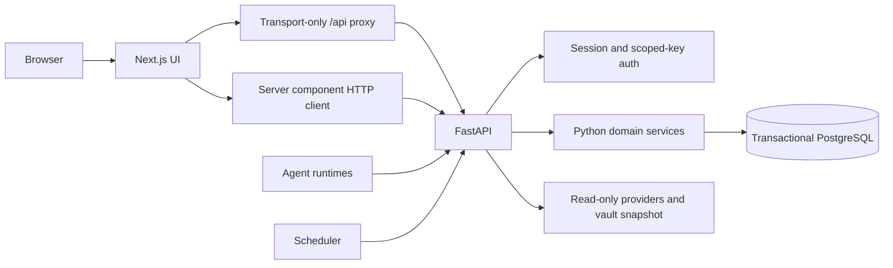

# Architecture

## Service boundary

`frontend/app/api/[...path]/route.ts` forwards HTTP only. It implements no task,
project, messaging, authentication, or integration policy. It preserves upstream
status, redirects, Set-Cookie, cookies, bearer headers, and request bodies.

Server components use `frontend/lib/api.ts`; it forwards the incoming user's cookie
rather than a shared administrator credential. `frontend/middleware.ts` asks
`/api/session` whether to show the login, locked, or unavailable screen. FastAPI
checks every protected request independently; middleware is not the security boundary.

The frontend keeps Markdown rendering/sanitizing, view formatting, and ID-to-label
lookups. Health/workload/analytics are computed by Python and supplied in `/api/state`.
The TypeScript domain mutation modules and original Next.js business route handlers
have been removed rather than maintained as competing backends.

## Backend modules

| Module | Responsibility |
| --- | --- |
| `main.py` | Application factory, lifecycle, error serialization, router registration |
| `config.py` | Backend-only settings and transitional dotenv loading |
| `auth.py` | scrypt verification, expiring HMAC sessions, scoped/master credentials |
| `schemas.py` | Validated wire payloads, preserving camelCase JSON compatibility |
| `domain.py` | Assignments, pickup, dependencies, reports, reviews, recurrence |
| `admin.py` | Registry, projects, templates, delegation, messaging |
| `repository.py` | PostgreSQL/SQLite adapters, transactions, explicit import |
| `monitoring.py` | Health, completion trends, workload, public state projection |
| `integrations.py` | Read-only OAuth/provider calls, Drive cache and snapshot fallback |
| `routers/` | HTTP handlers and authentication dependencies |
| `cli.py` | Explicit import/export and password-hash generation |

## API ownership

All listed routes are implemented by FastAPI. Paths are preserved for existing UI
forms and runtime clients.

| Routes | Authorization |
| --- | --- |
| `/health`, `/api/session`, `/api/login`, `/api/logout` | Public session/liveness operations |
| `/api/state`, `/api/tasks`, `/api/projects`, `/api/registry` | Dashboard session |
| `/api/registry/{id}/setup` | Dashboard session; scoped credential setup/revoke |
| `/api/automation`, `/api/messages`, `/api/logs` | Dashboard session |
| `/api/vault`, `/api/integrations` | Dashboard session |
| `/api/agents` | Master Bearer credential |
| `/api/agents/{id}/tasks`, `/activity`, `/messages`, `/review`, `/delegate` | That agent's scoped credential or master Bearer key |
| `/api/cron` | Separate CRON_SECRET Bearer credential |

OpenAPI is generated by FastAPI at `/openapi.json`, with Swagger UI at `/docs`.
Error responses use `error` for the existing frontend forms. Invalid typed request
bodies return 422 with field messages but no submitted input values.

## Persistence

Docker uses PostgreSQL 17, selected by `DATABASE_URL`. The compatible version-1
state is stored as a JSONB aggregate with a revision number. `SELECT ... FOR UPDATE`
serializes state mutations; each operation commits atomically or rolls back on
failure. Concurrent startup uses a transaction-level advisory lock for schema
creation and seeding. Connection, lock, and statement waits are bounded. This is
not yet a normalized table-per-entity schema.
Connection contexts follow Psycopg's documented [commit/rollback behavior](https://www.psycopg.org/psycopg3/docs/basic/transactions.html),
and records use its [JSONB adapter](https://www.psycopg.org/psycopg3/docs/basic/adapt.html#json-adaptation).

Without `DATABASE_URL`, the legacy SQLite adapter supports local development and
explicit migration exports. It uses WAL and `BEGIN IMMEDIATE` transactions.
The CLI imports into the configured adapter, validates records, and refuses to
replace populated state without an explicit flag. Docker PostgreSQL data lives
in a named volume, with no database port published to the host. The backend health
endpoint verifies database access. Compose waits for database and backend health.

There is no runtime dependency on the old Node Blob SDK. `tools/export-blob.mjs`
uses it only for a read-only, one-time data export.

## Settings and deployment

Provider tokens, dashboard passwords/hashes, WATCHTOWER_API_KEY and CRON_SECRET are
backend-only. Frontend environment examples contain only BACKEND_URL. Root legacy
dotenv files are supported temporarily and were not edited. Docker excludes dotenv
files from build contexts and injects the backend environment at runtime.

The optional Vercel deployment uses two container services in one project and a
frontend-to-backend `BACKEND_URL` binding. Vercel project variables are shared
server-side across services, unlike Compose's separate service environments; they
must never be exposed through `NEXT_PUBLIC_` names or client payloads. PostgreSQL
is managed externally. See the README for setup and the deployment script.

Sessions now have a signed server-verified expiry; old static v1 cookies are not
accepted. Password hashes keep the previous scrypt format and parameters. Scoped
agent credentials keep their SHA-256 hash format, preserving imported clients.

FastAPI does not execute agent task commands on the API host. The downloadable
runner executes locally selected commands on the agent machine. Likewise, recurring
work needs heartbeats or a separate authenticated cron worker; serving HTTP alone
does not provide an always-running scheduler.
